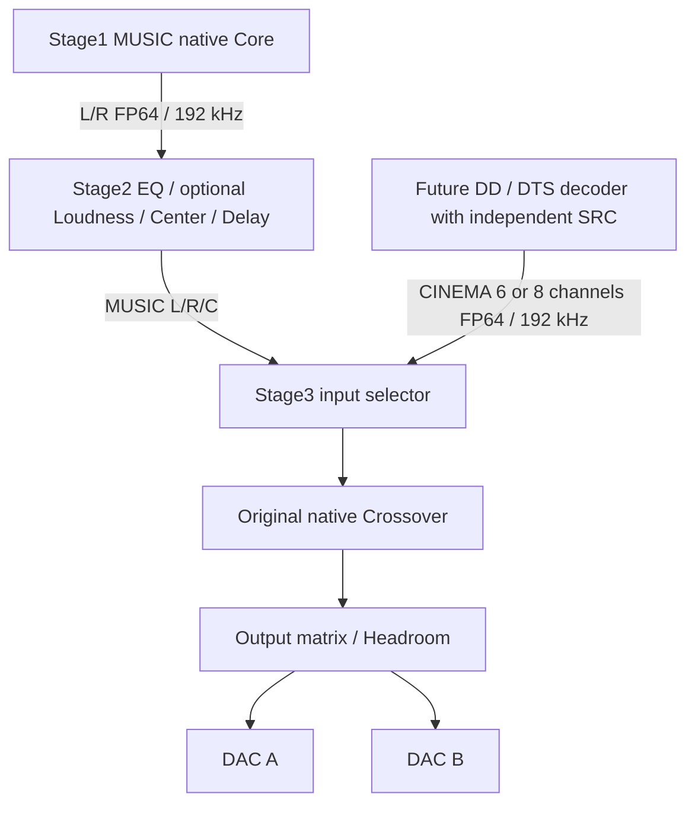

# Independent MUSIC / CINEMA architecture

Publication branch: `codex/music-cinema-architecture`, created from `v0.1.8`.
This branch publishes the completed local architecture and stable Stage3
0.1.9-v2 repair. Original release tags and the main branch are preserved.



## Ownership and contracts

Stage1 is an independent native source Core with a separate Qt presentation
process. Stage2 retains its existing DLL processing architecture; its MUSIC
contract is strictly two input channels and three output channels. Stage3
receives passive endpoints and does not control upstream source processes.
There is no Cinema processing path through Stage1 or Stage2 MUSIC.

MUSIC publication is planar FP64, 192000 Hz, 1024 frames, channel order L/R/C.
The independent Cinema contract accepts six channels FL/FR/FC/LFE/SL/SR or
eight channels with BL/BR appended. Height lanes remain reserved and zero.
Contracts and hashes are in `Transport/StageBusSDK`; endpoint overrides,
profile migration and selection behavior are described in
[Stage3 operation](../MUSIC-CINEMA-v2.md).

The selector consumes independently timed inputs. Valid source identities,
generations and format changes reset the relevant Crossover input histories
without resetting the downstream Graph-to-DAC clock. Serious output faults
automatically finish DISARM and retain the cause. Recovery requires an explicit
manual ARM, accepted directly when the source is ready; there is no automatic ARM.
Input MAX indicators are Sample Peak holds, measured from every valid received
block since Core startup, separate from instantaneous levels.

## Published sources and dependencies

| Component | Source location | Accepted local delivery |
| --- | --- | --- |
| Stage1 MUSIC | `Integration/Music/Stage1` | `stage1-native-music-v0002` |
| Stage2 MUSIC | `Integration/Music/Stage2` | `stage2-music-v0009` |
| Stage3 | Repository root | `0.1.9-v2`, 32k and 64k FIFO variants, both Windows x64 |

[Source snapshot provenance](source-snapshots.json) records original archive
SHA256 values, imported source counts and the Stage1 legacy ingress DLL hashes.
The complete imported snapshots include the packaged dependencies and the
original source-archive evidence. [Original delivery ZIPs](../../release/music-cinema)
for all three Stages are versioned on this private branch; their sizes and SHA256
values are recorded in [delivery-artifacts.json](delivery-artifacts.json).
Their original README and historical design documents retain the context in
which those snapshots were built; this handoff identifies the current direction.

Stage1 legacy provider and input matrix reference DLLs are included in
`Integration/Music/Stage1/reference-runtime`. The Stage2 interoperability runtime
is included at `Integration/Music/Stage2/release/stage2-music-v0009`.
Stage2 retains its existing DSP DLL modules at `Integration/Music/Stage2/runtime/stage2/modules`.
The Stage1 runtime is under `Integration/Music/Stage1/release/stage1-native-music-v0002`.
These are copies from immutable accepted archives, with their package manifests;
the active listening folders are untouched. The compiler, Intel IPP and Qt
development installations remain external build prerequisites.

Stage3 includes the pinned SRC source at
`local/stage04-ref/Stage3/native-reference/dependencies/SRC` and the immutable
Thiran test oracle at `local/thiran-baseline`. These two source directories are
explicitly versioned despite the general exclusion of local working files.
The local build uses MSVC 19.51 x64, Intel IPP 2026.0 static CPU dispatch,
CMake/Ninja, Python 3.9 and Qt 6.11.2 with MinGW 13.1 for UI only. Build scripts
retain the installation paths of the accepted Windows development environment.

```powershell
./tools/Build-MusicCinema.ps1 -FifoFrames 65536 -Verify -Parallel 2
./tools/Build-Stage05-UI.ps1 -BuildFolder build/qt-music-cinema
./tools/Test-MusicCinemaUi.ps1 -CoreBuild build/msvc-music-cinema-65536
```

Choose `-FifoFrames 32768` for the other variant. FIFO target remains 4096 frames.
Build/test processes use separate output directories and isolated test endpoints;
publication does not replace or restart the active listening packages.

## Validation and limits

The [accepted 0.1.9-v2 report](../VALIDATION-MUSIC-CINEMA-v2.json) records native
tests at 52/53 in both variants and Qt tests at 6/7. The remaining failures are
the inherited `EntropyStage04Offline` unsafe-PCM assertion and `EntropyStage05Ui`,
previously reproduced on the original baseline; their assertions are retained.
The report includes 72 unchanged protected DSP/egress source hashes and 2778
unchanged files in earlier delivered packages. Tests specifically cover passive
contracts, nonzero graph equivalence, source timeline changes and fault recovery.

The measured real MUSIC interval lasted 599.962 seconds and advanced 112496
Graph blocks with both eight-channel DACs running. No fault, gap, XRUN, overrange,
nonfinite, clipping or deadline failure was observed in that interval. Source
identity changes left both DAC epochs unchanged. This evidence qualifies that
tested interval; it does not prove the current Windows ingress drivers deliver
all original PCM samples under every condition. Real Cinema and analog alignment
remain pending, and the inherited formal V07 gate remains BLOCKED.

Fresh verification of this branch's assembled tree is recorded separately in
`publication-verification.json`; the accepted delivery report above is preserved.
Runtime/source ZIPs are included directly in this private Git branch. No GitHub
Release, new release tag or driver installation is created by this publication.

## Next phase: independent Stage1 driver number 3

Update11October2026: this phase is now implemented as development-signed
Music Render V2 **0.3.0.11** and separate Stage1 **v0003-r6**, paired with
user-mode Provider bundle **0.3.0.11-signed-dev-r3**. The kernel is unchanged.
The [r6 report](../../Integration/Music/Stage1-v0003/docs/V0003-R6-LIVE-RESULT.md)
records confirmed IDLE handling, known PCM/FP64 qualification and the remaining
unverified WASAPI access metadata. Historical r3 results are separate. The
[loaded report](../../validation/music-render-v2/LOADED-DRIVER-0.3.0.11.md)
records raw/FP64 continuity, the kernel passive-wait correction, AUX tests and
remaining qualification limits. Stage1v0002 and Stage2/Stage3 remain references.
The paragraphs below retain the requirements and observations at the first
architecture publication; they are not the current installation status.

The next driver must have its own device identity, independent of both existing
Transport and Entropy Audio Virtual devices. Its acceptance target is:

- WASAPI Exclusive with event-driven servicing.
- Integral PCM delivery, including format changes and stream start/stop boundaries.
- Correct clock and packet chronology, with zero lost, duplicated or corrupted frames.
- Explicit counters and reproducible tests comparing emitted PCM with received PCM.

The [completed Driver V2 handoff](DRIVER-V2-HANDOFF.md) defines the third independent
driver, its pinned Microsoft sample reference, raw Provider V2 integration,
clock/commit ownership and the three acceptance groups. Stage1 v0002 remains
an unchanged reference; the legacy FP64 adapters cannot certify original PCM identity.

The existing devices have suspected ingress defects; downstream Stage2/Stage3
stability narrows the investigation but does not alone establish a kernel-driver
root cause. Driver architecture, installation and implementation will be agreed
in the next phase. No new driver is installed or implemented by this publication.
The future Cinema decoder will publish its own FP64/192 kHz endpoint with its own
SRC, separately from the MUSIC source.
